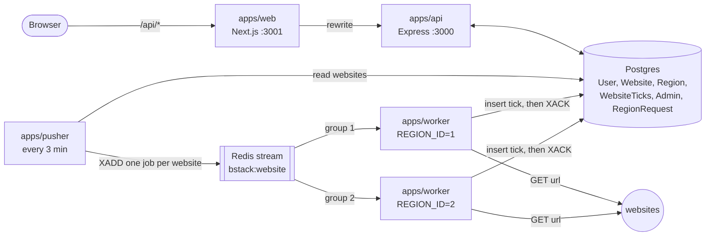

# bstack: uptime monitoring

A Better-Uptime-style monitor: sign up, add websites, and workers in several regions check them every few minutes, recording whether each was up and how fast it answered.

> **Branches.** `main` is your original code. `feature/web-frontend` adds the Next.js frontend. **`feature/ai-changed`** (this one) fixes the backend bugs, adds the endpoints, admins and region requests, connects the frontend to real data, adds tests, and documents every change for learning. Each package README lists the bugs in `main` with file:line, what changed, and what to add next.

- [How it works](#how-it-works)
- [Repository map](#repository-map)
- [Run it](#run-it)
- [What changed on this branch](#what-changed-on-this-branch)
- [Things to learn from this branch](#things-to-learn-from-this-branch)
- [What to build next](#what-to-build-next)

## How it works



1. You add a website (API → `Website` row).
2. The **pusher** puts every website on the Redis stream as a job, every 3 minutes.
3. Each **region** has a consumer group, so every region gets every job. Workers in a region share their group's jobs.
4. A **worker** requests the URL, stores a **tick** (Up/Down/Unknown, ms, HTTP code, reason, region, time), then acks the job.
5. The **frontend** reads your websites with their last 24 h of ticks and draws status, uptime % and response-time charts.

## Repository map

| Path | What | README |
|---|---|---|
| `apps/api` | Express 5 API: auth, websites, ticks, regions, region requests, health | [apps/api](apps/api/README.md) |
| `apps/worker` | Checks websites for one region | [apps/worker](apps/worker/README.md) |
| `apps/pusher` | Queues every website every few minutes | [apps/pusher](apps/pusher/README.md) |
| `apps/web` | Next.js 16 + Tailwind v4 + shadcn frontend (screenshots, diagrams) | [apps/web](apps/web/README.md) |
| `apps/tests` | `bun test` suite (32 tests) | [apps/tests](apps/tests/README.md) |
| `packages/redis` | `@repo/redis-stream`: the stream + consumer-group helpers | [packages/redis](packages/redis/README.md) |
| `packages/db-prisma` | `@repo/db-prisma`: Prisma 8 contract, migrations, `db` client | [packages/db-prisma](packages/db-prisma/README.md) |
| `apps/next-web` | An earlier frontend experiment (unchanged) | |
| `RUN.md` | Step-by-step: run the demo or the full stack | [RUN.md](RUN.md) |
| `README_details.md` | Your project notes from the backend checkpoint (kept as history) | [README_details.md](README_details.md) |
| `claude_tests/` | Manual curl test definitions and run logs | [tests.md](claude_tests/tests.md) |

## Run it

See **[RUN.md](RUN.md)**. In short:

```bash
bun install
# demo (no backend): NEXT_PUBLIC_MOCK=1, then bun run dev in apps/web
# full stack: Postgres + Redis, migrate, then api, pusher, worker, web
```

## What changed on this branch

| Area | Bugs fixed | Biggest changes |
|---|---|---|
| API | 14 | Passwords hashed, the JWT secret moved to `.env`, signup no longer returns the password, proper status codes, Zod validation, one error handler, no leaked stack traces, new endpoints, admins, region requests, `/health` |
| Worker | 14 | Ack **after** the tick is stored (no lost jobs), no false Down, request timeout, blocking reads, env config, auto group creation, pending recovery + `XAUTOCLAIM`, records HTTP code and reason |
| Pusher | 4 | Runs on an interval, pipelined bulk add, logs errors, exits cleanly |
| redis-stream | 7 | Lazy connect with timeout (no hang), `REDIS_URL`, stream trimming, group helpers |
| db-prisma | 7 | Unique region names, tick index, `http_status`/`error` columns, `Admin`/`RegionRequest` tables, client cleanup |
| Frontend | – | Real data everywhere, real delete, failure reasons, admin/user region pages |
| Tests | – | 32 automated tests against a separate test database |

Verified on this machine: type-check of every package, `bun test` (32/32), the web production build, and an end-to-end run (sign up → add monitors → real checks appear → user requests a region → admin approves → delete), plus crash recovery (an unacked job is picked up after a worker restart).

## Things to learn from this branch

Each item: the problem it solves, then how it works here.

### HTTP status codes say *what kind* of failure it was

Clients (the frontend, curl, monitoring) branch on the code, not the message text. With "409 for everything", the frontend couldn't tell "username taken" from "database down".

| Code | Meaning | Used for |
|---|---|---|
| 200 OK | It worked, here's data | reads, signin, approve |
| 201 Created | A new thing exists | signup, create website/region/request |
| 204 No Content | It worked, nothing to send | delete |
| 400 Bad Request | Your input is wrong; fix it and retry | Zod failures, bad JSON |
| 401 Unauthorized | Who are you? (no/invalid/expired token) | missing or bad token, wrong password |
| 403 Forbidden | I know who you are, but you can't do this | non-admin creating a region |
| 404 Not Found | Doesn't exist, **or isn't yours** | unknown route, other users' websites |
| 409 Conflict | Clashes with the current state | taken username, duplicate region, already decided |
| 500 Internal Server Error | Our bug; details only in the server log | anything unexpected |
| 503 Service Unavailable | Running, but a dependency is down | `/health` when Postgres doesn't answer |

**404 instead of 403 for someone else's website:** a 403 would confirm that the id exists. Returning 404 for "doesn't exist" and "not yours" alike leaks nothing.

### `Authorization: Bearer <token>`

The header has a scheme and a value. `Bearer` means "whoever holds this token is allowed"; there are other schemes (`Basic`, `Digest`). Using the standard scheme means every HTTP client, proxy and tool understands the header. `apps/api/src/auth.ts` reads `Bearer`, and accepts the raw token too for now, so old curl commands keep working.

### Never store passwords, store slow hashes

If the database leaks, plain-text passwords are instantly usable everywhere their owners reused them. `Bun.password.hash` uses **argon2id**: slow on purpose (so guessing billions of passwords is expensive), salted (the same password hashes differently for each user), and the salt and settings are stored inside the hash string. Old plain-text rows are upgraded on their next successful sign-in.

### Secrets live in the environment, not the code

The old JWT key was the example key from the jose README, committed to git. Anyone with it can sign a token saying "I am user X". Now `JWT_SECRET` comes from `.env` (gitignored), is checked for length at startup, and `.env.example` documents it without a value.

### Validate at the boundary (Zod)

Everything from outside (body, params, query) is untrusted. Parsing it once at the edge (`src/schemas.ts`) means route code only sees valid, typed data, and the client gets a 400 that lists each problem instead of a crash or a weird DB error.

### One error handler instead of try/catch everywhere

Routes `throw notFound()` or `throw conflict("...")`. Express 5 forwards errors from async handlers to the error middleware, which turns `HttpError` into its status and message, and anything else into a logged 500 with a generic message. That fixed the `res.json(400).json(...)` crash and the leaked stack traces in one place.

### At-least-once delivery: **ack after the work**

A queue can promise *at most once* (ack first: a crash loses the job) or *at least once* (ack after: a crash repeats the job). For monitoring, a repeated check is harmless and a lost one isn't. The old worker acked first; now it checks, stores the tick, **then** `XACK`s.

### Consumer groups, pending entries, XAUTOCLAIM

- A **consumer group** tracks which entries it has handed out; each entry goes to one consumer in the group. One group per region = every region checks every website.
- Delivered-but-unacked entries sit in the group's **pending list** (`XPENDING`).
- On restart, a worker reads its own pending entries with id `0`.
- If a worker dies for good, others take its entries with **`XAUTOCLAIM`** after they've been idle 5 minutes.

### `await` in a loop vs `Promise.all`

`await` never blocks the thread; it pauses *that* function. But `for (...) { await check() }` runs checks **one after another**. `Promise.allSettled(items.map(check))` **starts them all**, then waits once. `allSettled` (not `all`) so one failure doesn't hide the others' results.

### Schema migrations

The contract (`contract.prisma`) is the *desired* schema; migrations are the *steps* from one version to the next. They're planned offline, reviewed (the CLI prints the SQL), applied with `db migrate`, and committed, so every database (yours, the test DB, production) goes through the same steps. Keep the `db` ref pointing at the applied contract, or the next plan forks (see the db-prisma README).

### Testable code: split `app` from `listen()`

`apps/api/src/app.ts` builds the app; `index.ts` starts it. Tests import the app and call `listen(0)` (a random free port), then use real HTTP. Likewise the worker's `classify()` is pure, so it's tested without Redis or a database.

### Declaration merging

`declare global { namespace Express { interface Request { user_id?: string } } }` *adds* a field to Express's existing `Request` type, because interfaces with the same name merge. It now lives in `src/auth.ts` (the module that sets the field), so every program importing it, including the tests, sees the type.

## What to build next

1. **Alerts**: notify when a site is Down in two or more regions; notify again on recovery.
2. **Rate limiting** on signin/signup.
3. **httpOnly cookie sessions** instead of localStorage tokens.
4. **Tick retention and hourly rollups** (the ticks table grows forever).
5. **Per-website intervals, keyword and SSL-expiry checks.**
6. **CI**: run `bun test` and the type checks on every push, with Postgres and Redis as service containers.
7. **Deployment**: Dockerfiles; run workers in real regions.
