# web: bstack frontend

Next.js 16 (App Router) + Tailwind CSS v4 + shadcn/ui (`base-nova` style, Base UI primitives) frontend for the uptime monitor in `apps/api`.

- [Run it](#run-it)
- [Screenshots](#screenshots)
- [Page map](#page-map)
- [Interaction paths](#interaction-paths)
- [How it talks to the API](#how-it-talks-to-the-api)
- [Demo mode vs real data](#demo-mode-vs-real-data)
- [Code layout](#code-layout)

## Run it

```bash
bun run dev                  # http://localhost:3001
```

The web app runs on **3001** because the API (`apps/api`) uses 3000. Copy `.env.example` to `.env.local` if you need to change anything.

### Demo mode (no backend)

PowerShell:

```powershell
$env:NEXT_PUBLIC_MOCK = "1"; bun run dev
```

Everything (accounts, websites, regions, checks) is mock data kept in this browser's localStorage. Any username/password works and new accounts get five sample monitors, one of them in an ongoing outage. Usernames starting with `admin` are admins.

With the real stack (API + pusher + worker, see `RUN.md`) everything is real: your websites, their checks from every region, deletes, and region requests.

## Screenshots

Taken at 1280×800 (phone: 390×844). Most are in demo mode, which has 3 days of simulated history; the **real stack** shots show a fresh account a few minutes after adding two monitors.

### Real stack: dashboard and a monitor

| Dashboard (one site up, one down) | Monitor detail |
|---|---|
| 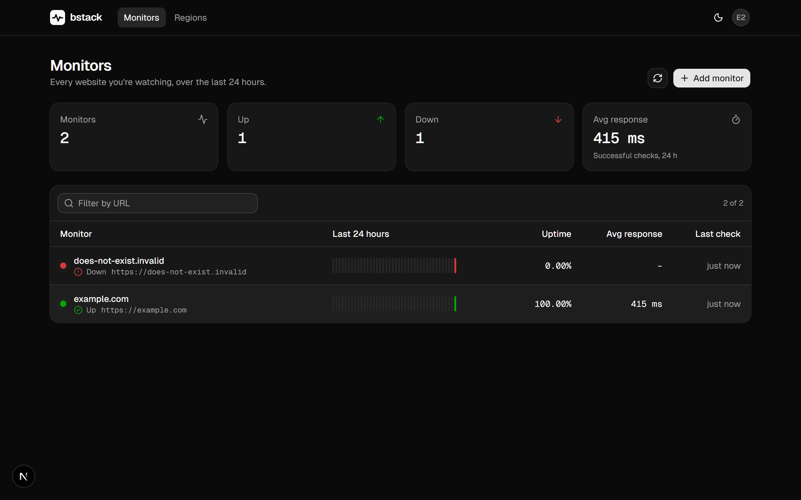 | 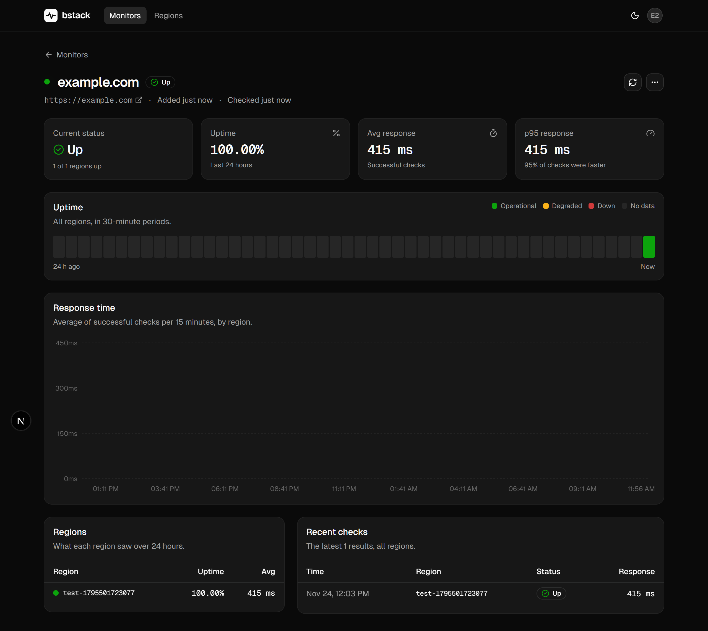 |

### Landing page `/`


<details>
<summary>Full landing page (features, how it works, call to action)</summary>

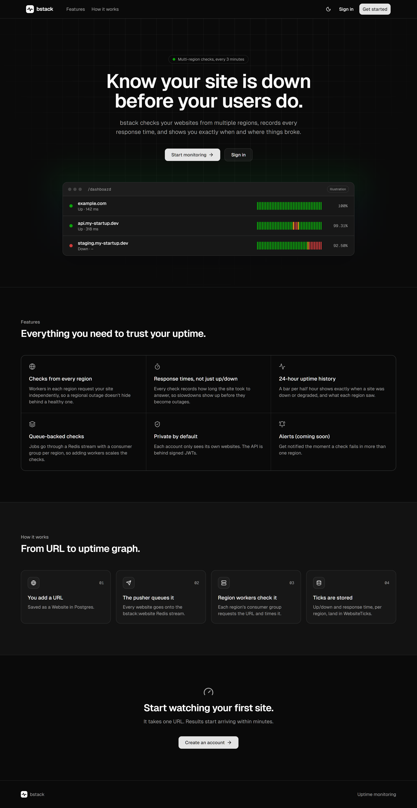

</details>

### Sign in `/signin` and sign up `/signup`

| Sign in | Sign up, with a validation error |
|---|---|
|  | 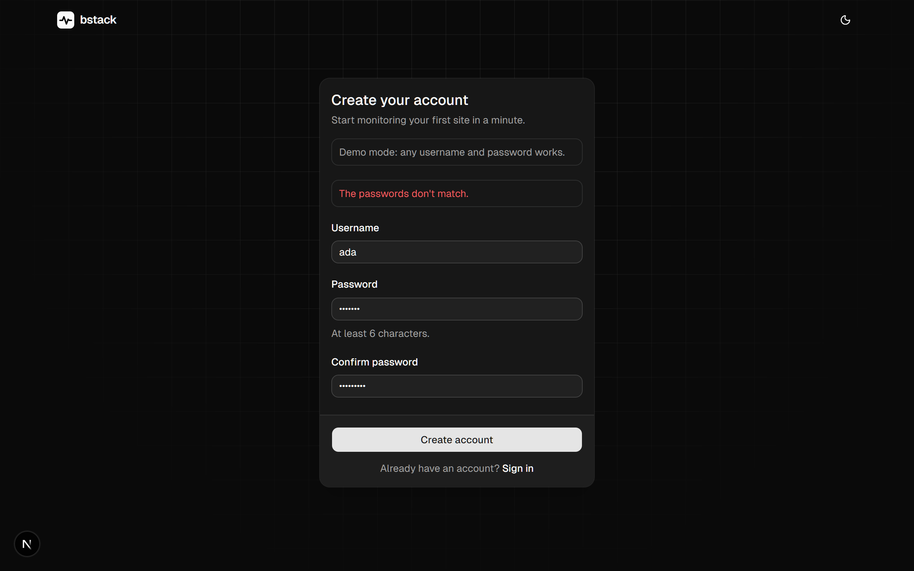 |

### Monitors dashboard `/dashboard`

Summary cards, then every monitor with its status, a 24-hour strip (one bar per ~36 min), uptime %, average response time and when it was last checked. Click a row to open it.


### Add monitor dialog

Opened from **Add monitor**. The preview shows `mysite.io` becoming `https://mysite.io`; the API applies the same rule and rejects anything that isn't an http(s) URL.

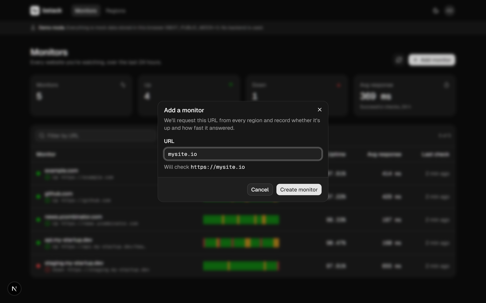

### Monitor detail `/dashboard/monitors/[id]`

Status, uptime, average and p95 response time; a 24-hour uptime bar (hover a bar for its counts); response time per region (hover for a crosshair tooltip); what each region saw; and the latest 15 checks. Failed checks show why: `HTTP 503`, `timed out after 10000 ms`, `connection refused`…

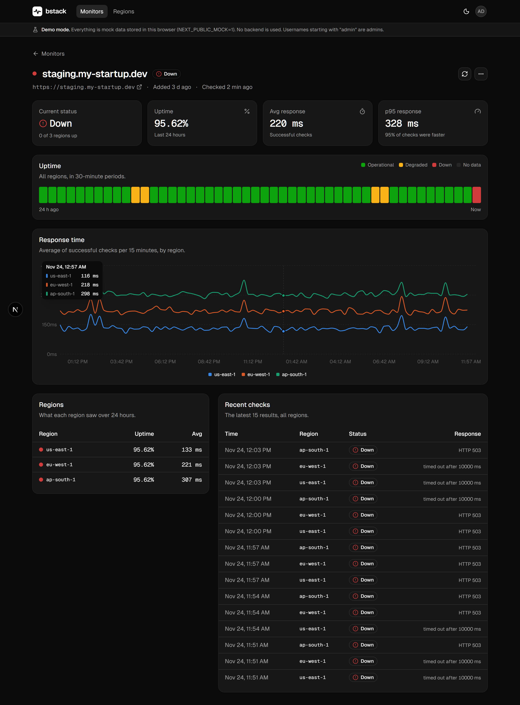

The **⋯** menu: copy the website id, open the site, or delete the monitor (with its history, after a confirm dialog).


### Regions `/dashboard/regions`

Regions are shared by everyone, so only **admins** create them. Everyone else **requests** one, and an admin approves (which creates it) or rejects.

| User: request a region, see your requests | Admin: create, approve or reject |
|---|---|
| 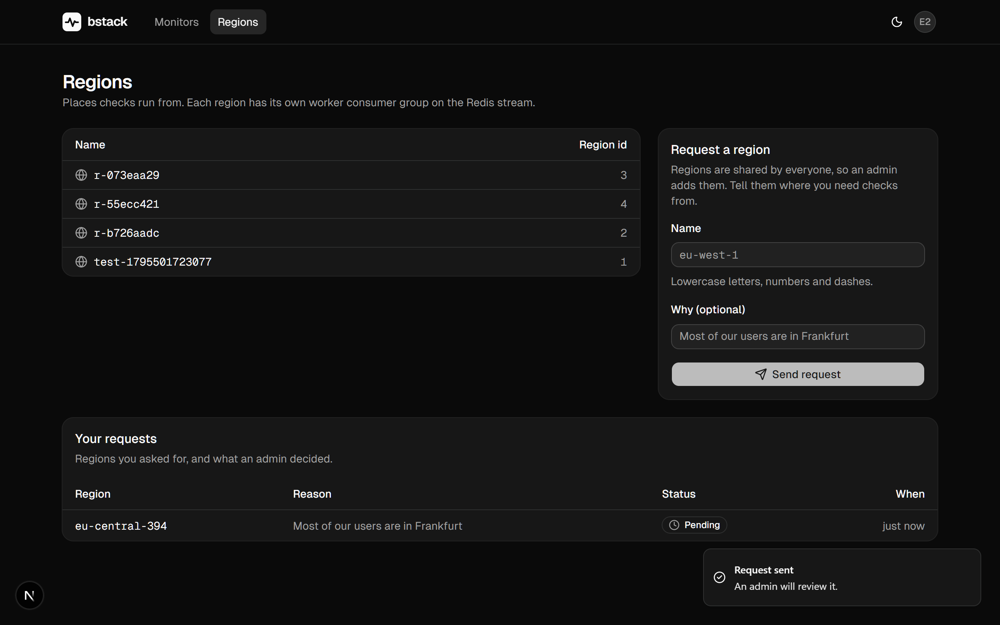 | 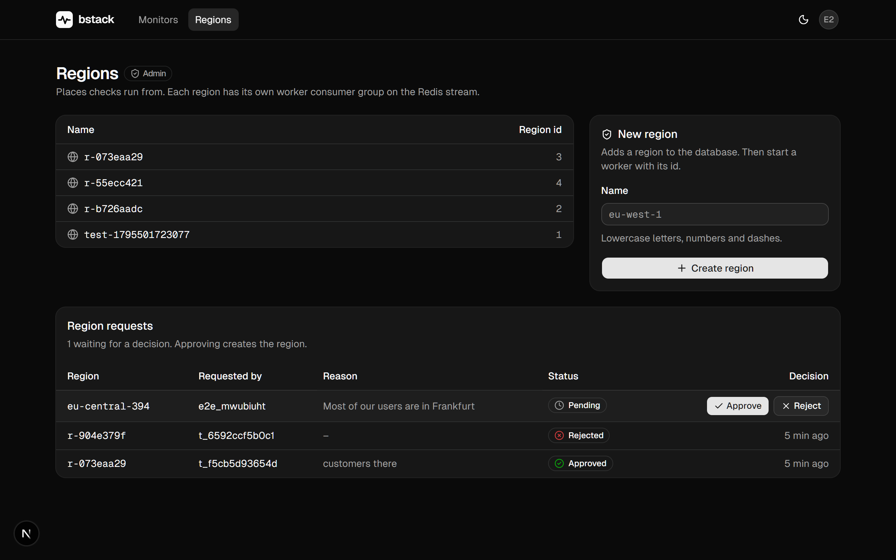 |

Names are checked in the browser too (lowercase, digits, dashes):


### Light theme and phone width

| Light theme | Phone (390 px) |
|---|---|
| 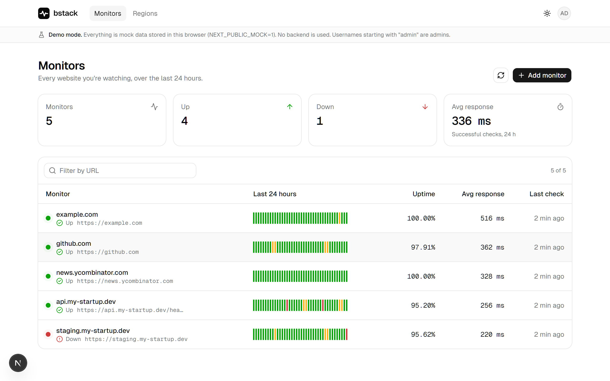 | 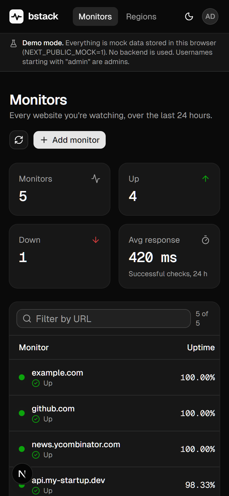 |

## Page map

Every route and how you get between them. Rounded boxes are public; square boxes need a session.

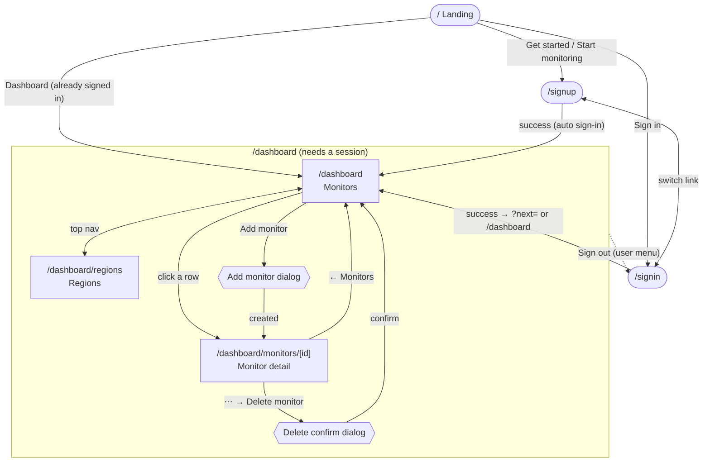

## Interaction paths

### Signing in, and the auth guard

The token lives in localStorage, so the guard runs in the browser (`app/dashboard/layout.tsx`). While it checks, the page shows skeletons.

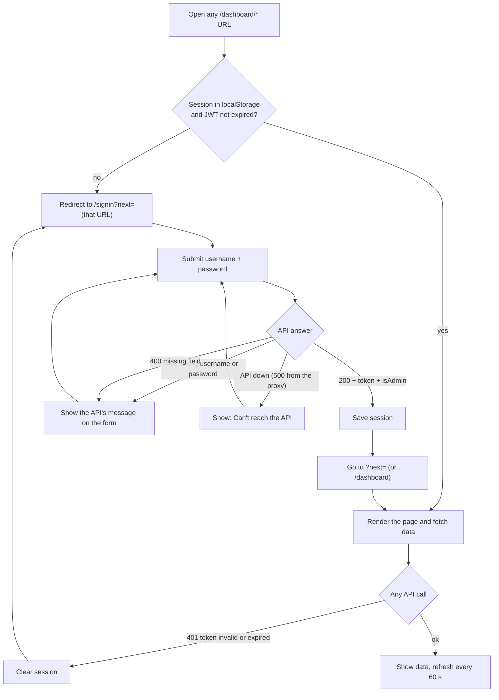

### Adding a monitor, and where its data comes from

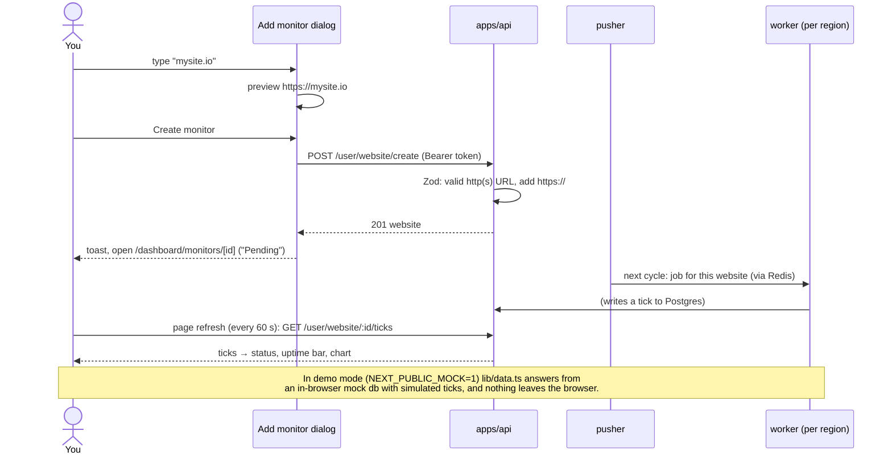

### Requesting and approving a region

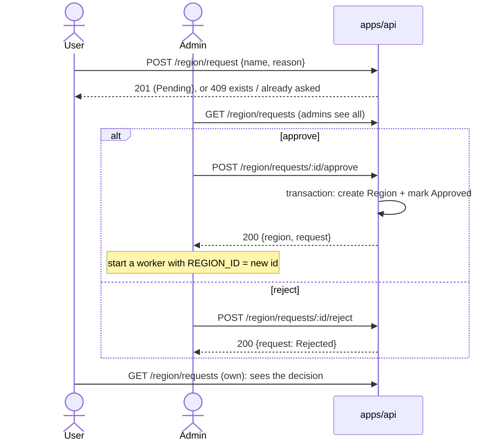

### Monitor lifecycle as the UI shows it

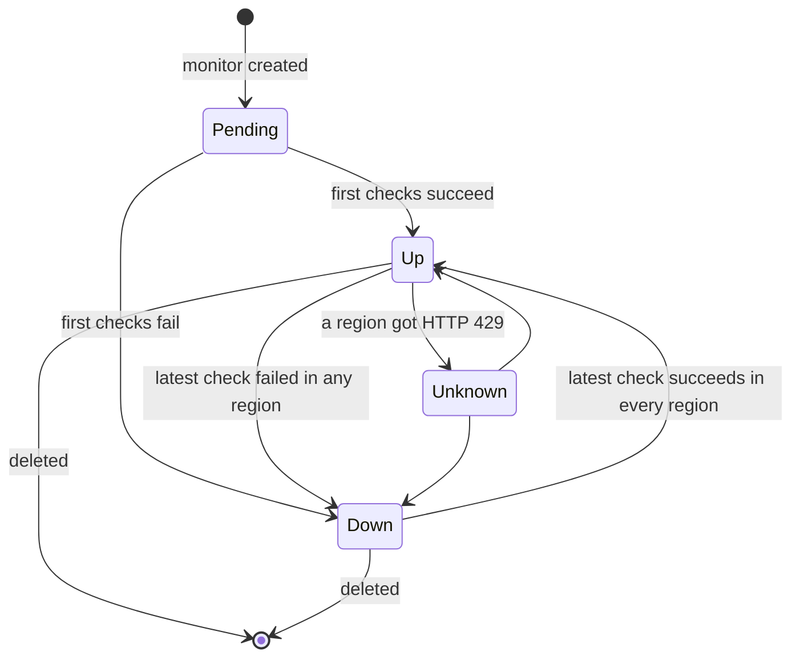

"Current status" is the worst of each region's latest check. Uptime % counts only Up and Down checks.

### What every control does

| Where | Control | What happens |
|---|---|---|
| Header (all pages) | Sun/moon icon | Theme menu: Light, Dark, System. Dark is the default. |
| Dashboard header | Avatar | Shows username (and "admin"), user id; **Sign out** clears the session and goes to `/signin`. |
| Dashboard | ↻ | Refetches now. Data also refreshes every 60 s. |
| Dashboard | **Add monitor** | Opens the add dialog. |
| Dashboard | Filter box | Filters rows by URL as you type. |
| Dashboard | A row, or its hostname | Opens the monitor detail page. |
| Monitor detail | Uptime bar | Hover or focus a bar: time range, status, up/down counts. |
| Monitor detail | Response chart | Hover: crosshair with each region's average at that time. |
| Monitor detail | Recent checks | Failed rows show the reason (`HTTP 503`, `timed out…`); hover for the full text. |
| Monitor detail | **⋯ → Copy website id** | Copies the id (for curl or the manual tests). |
| Monitor detail | **⋯ → Open website** | Opens the monitored URL in a new tab. |
| Monitor detail | **⋯ → Delete monitor** | Confirm dialog, then `DELETE /user/website/:id` (website and its history). |
| Regions (user) | **Send request** | Validates the name, then `POST /region/request`; it appears under "Your requests". |
| Regions (admin) | **Create region** | `POST /region/create`; the toast says which `REGION_ID` to start a worker with. |
| Regions (admin) | **Approve / Reject** | Decides a pending request; approving creates the region. |

### Loading, empty and error states

| State | What you see |
|---|---|
| Checking the session | Skeleton blocks |
| Loading data | Skeleton rows/cards |
| No monitors | "No monitors yet" with an Add monitor button |
| New monitor, no checks yet | Status "Pending", "Waiting for the first check", empty chart message |
| Unknown monitor id, or someone else's | "Monitor not found" with a link back (the API answers 404 for both) |
| API unreachable | Red alert with the message and **Try again** |
| Token rejected (401) | Signed out and sent to `/signin?next=…` |
| No requests yet | "No requests yet." |

## How it talks to the API

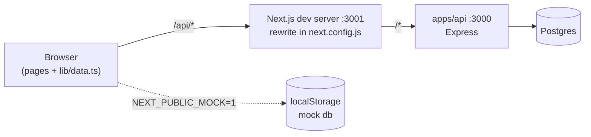

- **No CORS needed.** The browser calls `/api/*` on this app; `next.config.js` rewrites it to `API_URL` (default `http://localhost:3000`).
- **Auth:** the JWT from `/signin` is stored in localStorage (`bstack:session`, with `isAdmin`) and sent as `Authorization: Bearer <token>`. A **401** from any call signs you out and sends you to `/signin`.
- All data access goes through **`lib/data.ts`**. Pages never call `fetch` directly.

| Route | API calls |
|---|---|
| `/signin`, `/signup` | `POST /signin`, `POST /signup` (then `/signin`) |
| `/dashboard` | `GET /user/websites` (with 24 h of ticks), `GET /region/list` |
| `/dashboard/monitors/[id]` | `GET /user/website/:id`, `GET /user/website/:id/ticks`, `GET /region/list`, `DELETE /user/website/:id` |
| `/dashboard/regions` | `GET /region/list`, `GET /region/requests`, `POST /region/request` (user), `POST /region/create` and `POST /region/requests/:id/approve\|reject` (admin) |

## Demo mode vs real data

| | Real (`bun run dev`) | Demo (`NEXT_PUBLIC_MOCK=1`) |
|---|---|---|
| Accounts | `apps/api` | Any username/password, stored in localStorage |
| Websites | `apps/api` | localStorage; five samples per new account |
| Checks (ticks) | Written by the worker, read from the API | `simulateTicks()` in `lib/mock.ts`: 3 days of deterministic history |
| Admins | `ADMIN_USERNAMES` / `Admin` table | Usernames starting with `admin` |
| Banner | none | "Demo mode" banner on every dashboard page |

Charts, uptime bars and stats are computed the same way in both modes, by `lib/stats.ts`, from a `WebsiteTick[]` shaped like the Prisma model.

## Code layout

```
app/
  page.tsx                    landing
  (auth)/signin, signup       auth pages (shared components/auth-form.tsx)
  dashboard/                  client-guarded app
    page.tsx                  monitors list
    monitors/[id]/page.tsx    monitor detail
    regions/page.tsx          regions, region requests (admin and user views)
components/
  ui/                         shadcn components (generated: `bunx shadcn add <name>`)
  uptime-bar.tsx, response-chart.tsx, status.tsx, add-monitor-dialog.tsx, …
lib/
  api.ts      typed fetch client for apps/api
  data.ts     the data layer the UI uses (real API or demo mock)
  mock.ts     demo mode: mock backend + tick simulator
  stats.ts    uptime %, avg/p95, buckets, chart series
  session.ts  token storage
docs/screenshots/             images used in this README
```

## Theme

Dark by default with a light/system toggle (`next-themes`). Status colors are `--up`, `--down`, `--unknown` in `app/globals.css`, and status is always shown with an icon or label too, never by color alone. Region lines use `--chart-1..3`, a palette checked for color-blind readability.
