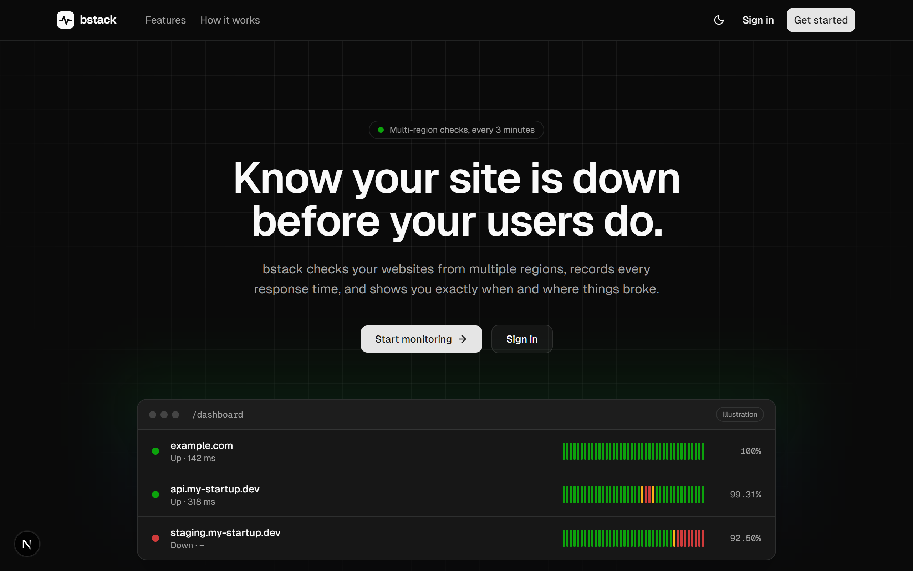
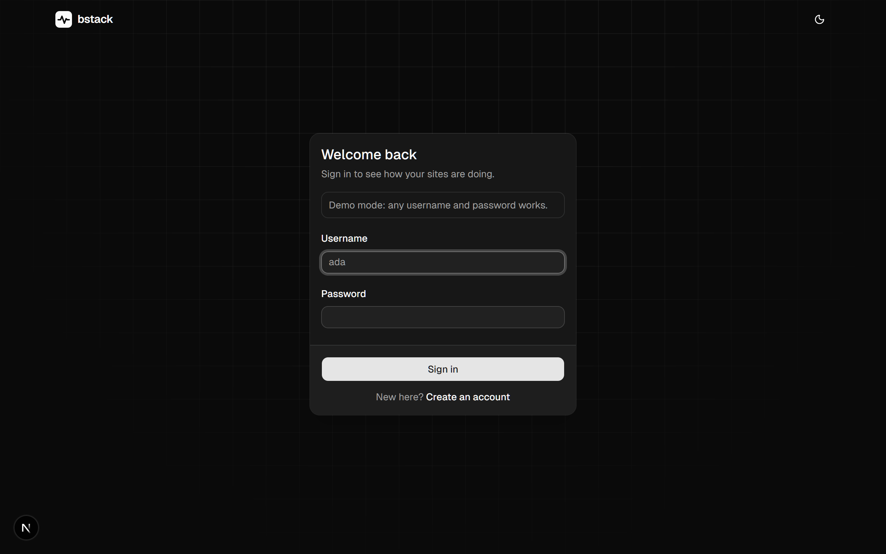
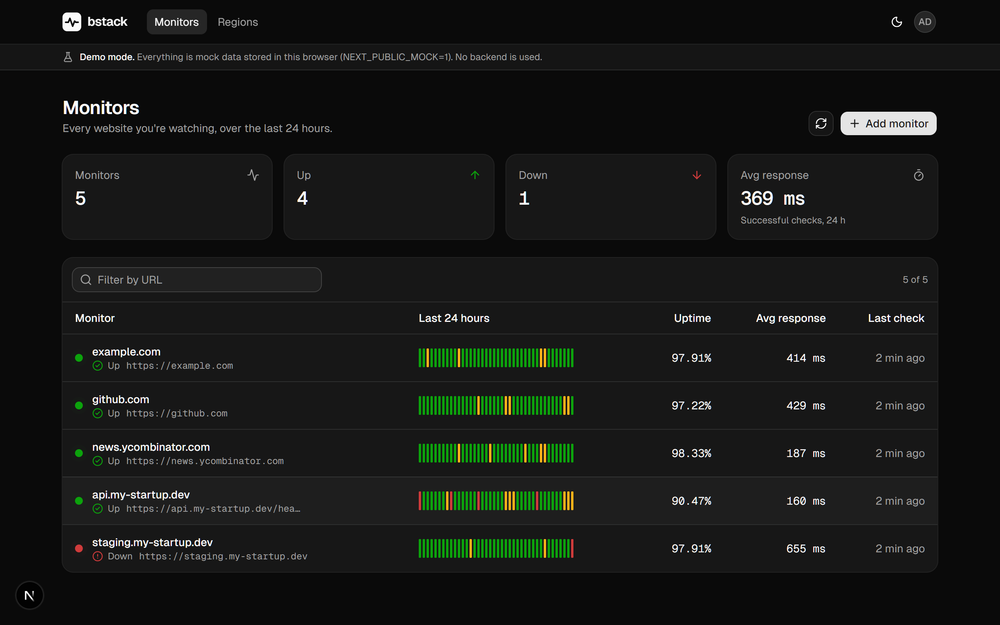
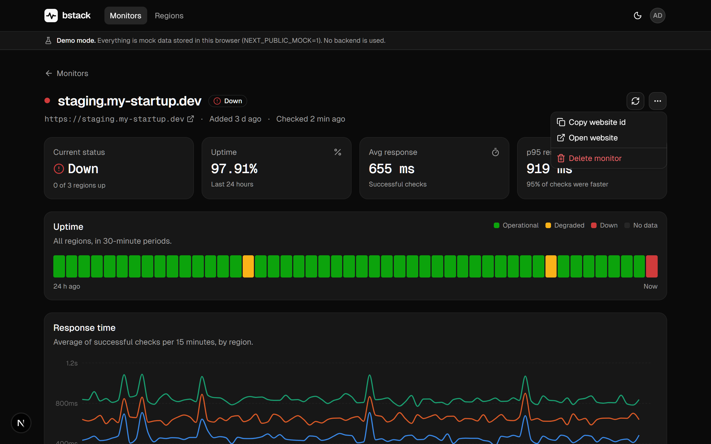
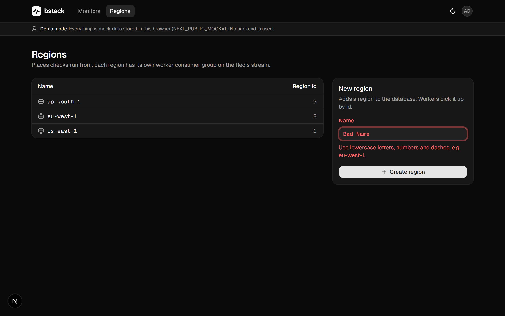
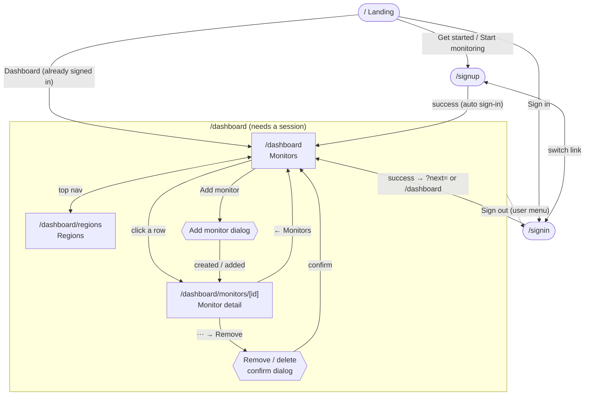
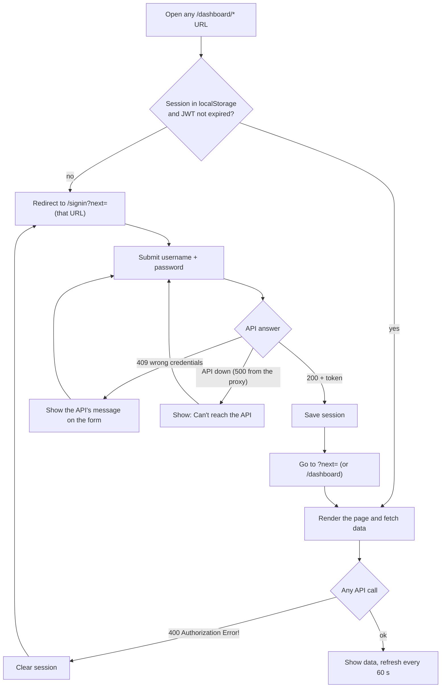
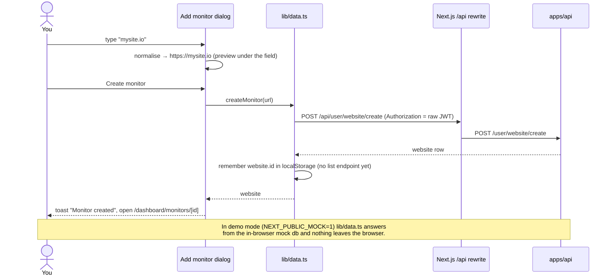
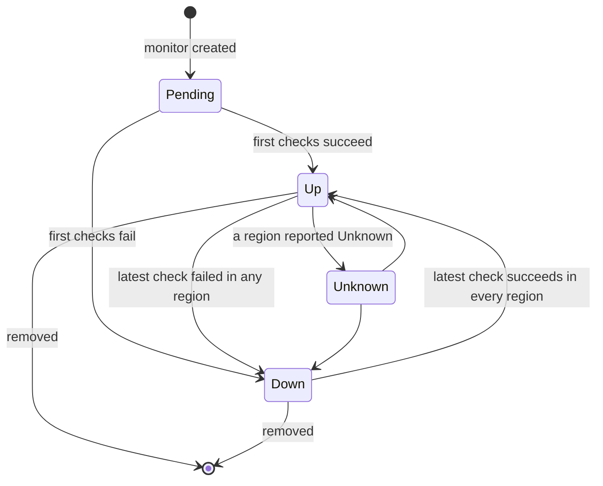
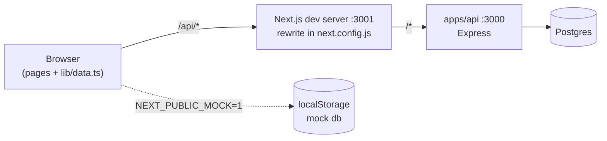

# web: bstack frontend

Next.js 16 (App Router) + Tailwind CSS v4 + shadcn/ui (`base-nova` style, Base UI primitives) frontend for the uptime monitor in `apps/api`.

- [Run it](#run-it)
- [Screenshots](#screenshots)
- [Page map](#page-map)
- [Interaction paths](#interaction-paths)
- [How it talks to the API](#how-it-talks-to-the-api)
- [What's simulated, and how to replace it](#whats-simulated-and-how-to-replace-it)
- [Code layout](#code-layout)

## Run it

```bash
bun run dev                  # http://localhost:3001
```

The web app runs on **3001** because the API (`apps/api`) uses 3000. Copy `.env.example` to `.env.local` if you need to change anything.

### Demo mode (no backend)

PowerShell:

```powershell
$env:NEXT_PUBLIC_MOCK = "1"; bun run dev
```

Everything (accounts, websites, regions, checks) is mock data kept in this browser's localStorage. Any username/password works and new accounts get five sample monitors, one of them in an ongoing outage.

## Screenshots

All taken in demo mode at 1280×800 (phone: 390×844).

### Landing page `/`



<details>
<summary>Full landing page (features, how it works, call to action)</summary>


</details>

### Sign in `/signin` and sign up `/signup`

| Sign in | Sign up, with a validation error |
|---|---|
|  |  |

### Monitors dashboard `/dashboard`

Summary cards, then every monitor with its status, a 24-hour strip (one bar per ~36 min), uptime %, average response time and when it was last checked. Click a row to open it.



### Add monitor dialog

Opened from **Add monitor**. `mysite.io` is normalised to `https://mysite.io` before it's sent, because the worker needs a full URL. With the real API, a link under the field switches to "add an existing website by id".


### Monitor detail `/dashboard/monitors/[id]`

Status, uptime, average and p95 response time; a 24-hour uptime bar (hover a bar for its counts); response time per region (hover for a crosshair tooltip); what each region saw; and the latest 15 checks.


The **⋯** menu: copy the website id, open the site, or remove the monitor.



### Regions `/dashboard/regions`

Lists regions and creates new ones. Names are checked before sending (lowercase, digits and dashes), because the API never answers an empty name.



### Light theme and phone width

| Light theme | Phone (390 px) |
|---|---|
|  |  |

## Page map

Every route and how you get between them. Rounded boxes are public; square boxes need a session.



## Interaction paths

### Signing in, and the auth guard

The token lives in localStorage, so the guard runs in the browser (`app/dashboard/layout.tsx`). While it checks, the page shows skeletons.



### Adding a monitor



### Monitor lifecycle as the UI shows it



"Current status" is the worst of each region's latest check. Uptime % counts only Up and Down checks.

### What every control does

| Where | Control | What happens |
|---|---|---|
| Header (all pages) | Sun/moon icon | Theme menu: Light, Dark, System. Dark is the default. |
| Dashboard header | Avatar | Shows username and user id; **Sign out** clears the session and goes to `/signin`. |
| Dashboard | ↻ | Refetches now. Data also refreshes every 60 s. |
| Dashboard | **Add monitor** | Opens the add dialog. |
| Dashboard | Filter box | Filters rows by URL as you type. |
| Dashboard | A row, or its hostname | Opens the monitor detail page. |
| Add dialog | "Add it by id" link (real API only) | Switches to pasting the id of a website made with curl or the tests. |
| Monitor detail | Uptime bar | Hover or focus a bar: time range, status, up/down counts. |
| Monitor detail | Response chart | Hover: crosshair with each region's average at that time. |
| Monitor detail | **⋯ → Copy website id** | Copies the id (handy for "add by id" in another browser). |
| Monitor detail | **⋯ → Open website** | Opens the monitored URL in a new tab. |
| Monitor detail | **⋯ → Remove / Delete** | Confirm dialog. Real API: hides it in this browser only (no delete endpoint). Demo: deletes it. |
| Regions | **Create region** | Validates the name, then `POST /region/create`. |

### Loading, empty and error states

| State | What you see |
|---|---|
| Checking the session | Skeleton blocks |
| Loading data | Skeleton rows/cards |
| No monitors | "No monitors yet" with an Add monitor button |
| New monitor, no checks yet | Status "Pending", "Waiting for the first check", empty chart message |
| Unknown monitor id | "Monitor not found" with a link back |
| API unreachable | Red alert with the message and **Try again** |
| Token rejected | Signed out and sent to `/signin?next=…` |

## How it talks to the API



- **No CORS needed.** The browser calls `/api/*` on this app; `next.config.js` rewrites it to `API_URL` (default `http://localhost:3000`).
- **Auth:** the JWT from `/signin` is stored in localStorage (`bstack:session`) and sent as the raw `Authorization` header (no `Bearer`), as `apps/api/middleware.ts` expects. A 400 `"Authorization Error!"` from the API signs you out and sends you to `/signin`.
- All data access goes through **`lib/data.ts`**. Pages never call `fetch` directly.

| Route | API calls |
|---|---|
| `/signin`, `/signup` | `POST /signin`, `POST /signup` (then `/signin`) |
| `/dashboard` | `GET /region/list`, `GET /user/website/:id` for each remembered id |
| `/dashboard/monitors/[id]` | `GET /user/website/:id`, `GET /region/list` |
| `/dashboard/regions` | `GET /region/list`, `POST /region/create` |

## What's simulated, and how to replace it

The API is missing a few endpoints, so `lib/data.ts` fills the gaps. The dashboard shows a banner saying so.

| Gap in the API | What the frontend does now | Swap it for |
|---|---|---|
| No "list my websites" endpoint | Remembers ids of websites created in this browser (`bstack:websites:<userId>`) and fetches each one. Websites created elsewhere (curl, tests) can be added by id from the "Add monitor" dialog. | `GET /user/websites` → replace the id loop in `listMonitors` |
| No endpoint for ticks | `simulateTicks()` in `lib/mock.ts` makes 24 h of deterministic checks every 3 min per region | Return ticks from the API (e.g. `GET /user/website/:id/ticks?since=…`) and drop `simulateTicks` in `toMonitor` |
| No delete endpoint | "Remove from dashboard" only forgets the id locally | `DELETE /user/website/:id` → call it in `removeMonitor` |

Once ticks come from the API, every chart, uptime bar and stat works unchanged: they're computed in `lib/stats.ts` from a `WebsiteTick[]` shaped like the Prisma model.

## Code layout

```
app/
  page.tsx                    landing
  (auth)/signin, signup       auth pages (shared components/auth-form.tsx)
  dashboard/                  client-guarded app
    page.tsx                  monitors list
    monitors/[id]/page.tsx    monitor detail
    regions/page.tsx          regions
components/
  ui/                         shadcn components (generated: `bunx shadcn add <name>`)
  uptime-bar.tsx, response-chart.tsx, status.tsx, add-monitor-dialog.tsx, …
lib/
  api.ts      typed fetch client for apps/api
  data.ts     the data layer the UI uses (real / hybrid / mock)
  mock.ts     tick simulator + full mock backend
  stats.ts    uptime %, avg/p95, buckets, chart series
  session.ts  token + known-website storage
docs/screenshots/             images used in this README
```

## Theme

Dark by default with a light/system toggle (`next-themes`). Status colors are `--up`, `--down`, `--unknown` in `app/globals.css`, and status is always shown with an icon or label too, never by color alone. Region lines use `--chart-1..3`, a palette checked for color-blind readability.
