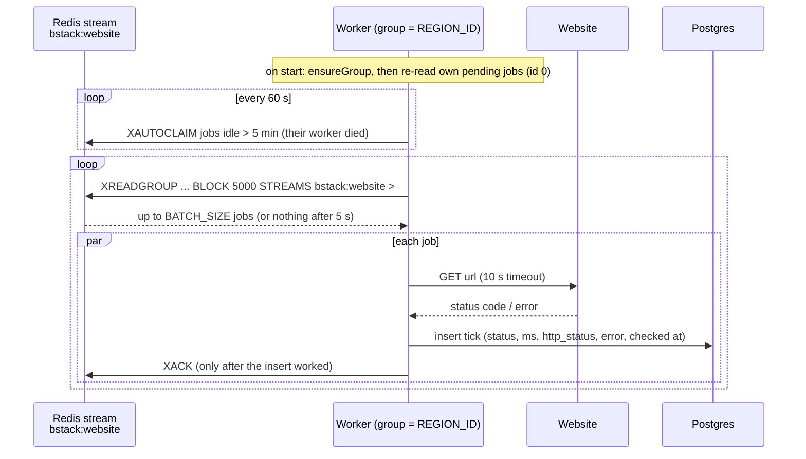

# worker

Takes website jobs from the Redis stream for **one region**, requests each website, stores the result as a `WebsiteTicks` row, then acks the job. Run one or more per region.

- [Run it](#run-it)
- [How a job flows](#how-a-job-flows)
- [Bugs found in the original code](#bugs-found-in-the-original-code)
- [Shortcomings and design notes](#shortcomings-and-design-notes)
- [What I changed](#what-i-changed)
- [What you should add next](#what-you-should-add-next)
- [Your notes from the code, answered](#your-notes-from-the-code-answered)

## Run it

Needs the same `DATABASE_URL` as the API in `apps/worker/.env`, plus:

| Variable | Required | What it does |
|---|---|---|
| `REGION_ID` | yes | Id of a row in `Region`. Also the consumer-group name. |
| `WORKER_ID` | yes | This worker's consumer name. Keep it **the same across restarts** (that's how it finds its unfinished jobs) and **different for each worker** in a region. |
| `REDIS_URL` | no | Default `redis://localhost:6379` |
| `BATCH_SIZE` | no | Jobs per read, default 10 |
| `CHECK_TIMEOUT_MS` | no | Per-request timeout, default 10000 |

```powershell
$env:REGION_ID = "1"; $env:WORKER_ID = "w1"; bun index.ts
```

Two workers in the same region share the work; workers in different regions each check every website.

## How a job flows



**Status rule** (`check.ts` → `classify`): 2xx/3xx **Up**; 429 **Unknown** (the site refused to tell us); any other code **Down** with `HTTP <code>`; no response at all **Down** with the reason (timeout, DNS, connection refused).

**Delivery is at-least-once:** if the worker dies after the check but before the ack, the job is checked again later. That can produce a duplicate tick, but never a lost check.

## Bugs found in the original code

Line numbers refer to `main` (`apps/worker/index.ts`).

| # | Where | Bug | Effect |
|---|---|---|---|
| 1 | `:51-55` | Every job is acked in a loop **before** any check runs | A crash, or an error mid-batch, **loses those jobs**: they're acked, so nobody retries them |
| 2 | `:90` | `console.log(promisesAxiosArray)` inside the `.map` callback, before the variable is assigned | `ReferenceError` in every job, after the tick is written. Every `allSettled` result is `rejected`, silently |
| 3 | `:65-87` | The DB insert is in the same `try` as `axios.get` | If the **insert** fails for a healthy site, the `catch` writes a **Down** tick: a false outage |
| 4 | `:66` | `axios.get(url)` without a timeout | One hanging website blocks the batch, and so the worker, forever |
| 5 | `:66` | axios throws on every non-2xx | A 404 or 503 lands in the `catch` with no status code saved; you can't tell why it was Down |
| 6 | `:45` | An empty read **throws** `Stream empty` | The worker crashes whenever there's no work |
| 7 | `:39-41` | `xReadGroup` without `BLOCK` in a `while(1)` | With the throw removed, it would be a busy loop hammering Redis |
| 8 | `:7`, `:11` | `REGION_ID = "1"`, `WORKER_ID = "1"` hard-coded | Can't run a second region or worker |
| 9 | `:75`, `:84` | `region_id: 1` hard-coded | Even with `REGION_ID` set, ticks are saved as region 1 |
| 10 | `:51` | `for (const message of websitesFromStream[0]?.messages)` | If `[0]` is undefined this is `for…of undefined` → `TypeError` |
| 11 | (missing) | Consumer group created by hand in `redis-cli` | A new region silently gets no jobs until someone runs `XGROUP CREATE` |
| 12 | (missing) | Pending jobs never re-read, never claimed | Jobs of a crashed worker stay pending forever |
| 13 | `:34` | `fetchWebsite` is empty | Dead code |
| 14 | `:57-89` | `allSettled` results never inspected | Failures are invisible |

## Shortcomings and design notes

- **One process checks a batch concurrently** (`Promise.allSettled` over `BATCH_SIZE` jobs). That's I/O-bound waiting, which one Node/Bun process handles well; see the `cluster` answer below.
- **Duplicate ticks are possible** after a crash (at-least-once). Making the insert idempotent (e.g. a unique key on `(website_id, region_id, stream id)`) would remove them.
- **Status is per request.** One slow response marks a site Down for that tick. Alerting should require several failures and more than one region.
- **No keyword or certificate checks**: only "did it answer 2xx/3xx".

## What I changed

- `check.ts`: one pure `classify()` (unit-tested in `apps/tests/worker.test.ts`) and `checkWebsite()` that **never throws**: timeout, `validateStatus: () => true` (a 503 is a result, not an exception), readable error reasons, a User-Agent, and a 5 MB body cap.
- `index.ts`: env-driven `REGION_ID`/`WORKER_ID` (fails fast if missing or if the region doesn't exist); `ensureGroup`; recovers its own pending jobs on start (id `0`); `XAUTOCLAIM` every minute for jobs stuck more than 5 minutes; `BLOCK 5000` reads; **insert, then ack**; a failed insert isn't acked (retried later) unless the website was deleted (then acked, since it can never succeed); per-job failures logged; Ctrl+C finishes the current batch, then exits.
- Ticks now store `http_status`, `error`, and **the time the check started** as `createdAt`.

## What you should add next

1. **Alerting**: when a website's latest ticks are Down in ≥ 2 regions, notify the owner once (and once when it recovers).
2. **Idempotent inserts** (see above) to drop duplicates after crashes.
3. **Metrics**: jobs/second, check latency, pending count (`XPENDING`), exposed for Prometheus.
4. **Keyword / SSL-expiry checks** as optional per-website settings.
5. **Dead-letter handling**: a job that has failed N times (`XPENDING` shows the delivery count) goes to a separate stream instead of retrying forever.
6. A Dockerfile so each region's workers can run on a machine in that region.

## Your notes from the code, answered

| Your comment (`main`) | Answer |
|---|---|
| "need worker id to later distribute tasks … according to region" (`:9`) | Inside a consumer group, Redis hands each job to exactly one consumer (the `WORKER_ID`). The group itself is the region. So: one group per region, one consumer name per worker. |
| "need a redis stream function to create Consumer groups based on regions" (`:22`) | Added: `ensureGroup()` in `@repo/redis-stream`, called on startup. `BUSYGROUP` (already exists) is ignored. |
| "separate the fetch functions" (`:32`) | Done: `check.ts`. Separating it also made it testable without Redis or a DB. |
| "separate the db upload to another queue ig" (`:33`), "storage … routed through queue" (`:99`) | Not needed yet: one insert per check is cheap for Postgres. A second queue becomes worth it when inserts are the bottleneck (thousands per second) or you want to batch them. |
| "have to do something instead of throwing error" (`:44`) | An empty read is normal. With `BLOCK 5000` the read waits up to 5 s for work and returns `[]` if none came; the loop just continues. |
| "can use map function instead of this" (`:50`), "using map function" (`:56`) | Yes. `messages.map(handle)` starts every check at once; `Promise.allSettled` waits for all of them. |
| "writing the types for promises" (`:57`) | `Promise.allSettled(messages.map(handle))` is `Promise<PromiseSettledResult<void>[]>`; each result is `{status:"fulfilled", value}` or `{status:"rejected", reason}`. See `processBatch`. |
| "cant await this will hold up the thread ig so gotta promise all" / "does await hold up the thread? context switching" (`:62-63`) | `await` **doesn't block the thread**; it pauses *that async function* and lets the event loop run other work. But in a `for` loop, `await` makes each iteration wait for the previous one, so checks run **one after another**. With `.map`, every promise is **created first** (all requests start), then you await them together. Same thread, no context switching: just many sockets waiting at once. |
| "there is a default createdAt but that is not the time at which the site was queried" (`:70-71`) | Good catch. The worker now sets `createdAt` to the moment the check started. |
| "take message.url and hit the site / put the result … / then acknowledge" (`:91-93`), "then give acknowledgement … so that the next worker is not refed" (`:101`) | That's exactly the right order, and now the code follows it: check, store, **then** ack. Acking first (what the old loop did) is what loses jobs. |
| Commit message: "can i use cluster module to fork workers" | You can, but it doesn't buy much here: checks are network waiting, not CPU work, and one process already runs a whole batch concurrently. To scale, **run more worker processes** with different `WORKER_ID`s (same region); the consumer group splits jobs between them. `cluster` is for sharing one server port across CPU cores. |
