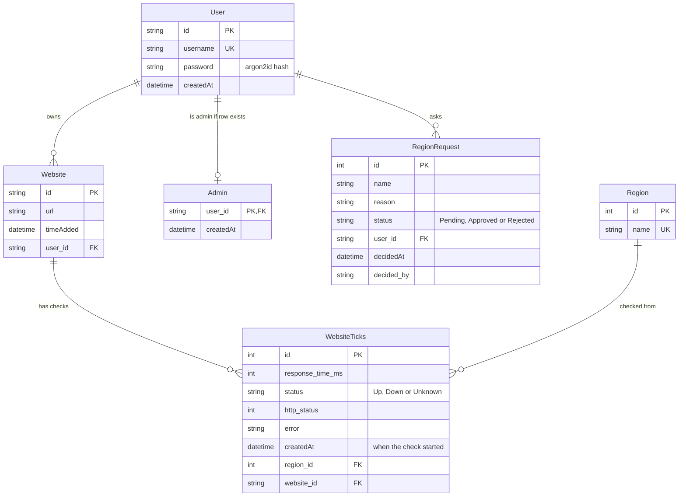

# @repo/db-prisma

The database contract (Prisma 8), its migrations, and the shared `db` client every app imports.

```ts
import { db } from "@repo/db-prisma/db";
const sites = await db.orm.public.Website.where({ user_id }).all();
```

`prisma-8.md` in this folder is Prisma's own getting-started guide.

## Tables



Index: `WebsiteTicks(website_id, createdAt)`, for "this website's checks since X", the query behind every chart.

## Changing the schema (the workflow)

Run from `packages/db-prisma` (it reads `DATABASE_URL` from this folder's `.env`):

```bash
# 1. edit src/prisma/contract.prisma
bunx prisma contract emit                    # regenerate contract.json + contract.d.ts
bunx prisma migration plan --name what_changed
#    review migrations/app/<timestamp>_what_changed (it prints the SQL)
bunx prisma db migrate                       # apply to the database
bunx prisma migration status                 # check: "Up to date"
```

Keep the first line of `contract.prisma`, `// use prisma-8`. It's a directive, not a comment: the CLI ignores files without it.

### The fork I ran into (and how to avoid it)

`migrations/app/refs/db.json` is a named pointer (`db`) to "the contract the database is at". `migration plan` starts from it by default. It still pointed at the **baseline**, although `region_id_to_autoincrement` had been applied after it. So the first plan *repeated* those two steps and forked the migration graph. The fix:

```bash
bunx prisma migration plan --from 22f1476 --name ...          # plan from the applied contract
bunx prisma migration ref set db <hash of the new contract>   # move the pointer afterwards
```

After each `db migrate`, move the `db` ref to the new contract hash (printed by `contract emit` as `storageHash`).

## Migrations

| Migration | What it does |
|---|---|
| `20261111T0451_baseline` | User, Website, Region, WebsiteTicks, status enum |
| `20261123T1507_region_id_to_autoincrement` | Region/WebsiteTicks ids autoincrement (yours) |
| `20261124T0620_admins_region_requests_tick_details` | `Admin` and `RegionRequest` tables; `WebsiteTicks.http_status` and `.error`; unique `Region.name`; index on `WebsiteTicks(website_id, createdAt)`. Additive only: no data dropped or rewritten |

## Bugs found in the original code

| # | Where (`main`) | Bug | Effect |
|---|---|---|---|
| 1 | `db.ts:6-8` | Unused imports `warn`, `before`, `SqlMigrationRunnerFailure` (the last one isn't exported) | The only type error in the backend |
| 2 | `db.ts:23` | Query logger always on | Every SQL statement printed in every app, including the worker's thousands of inserts |
| 3 | `db.ts:20-24` | A new client every time the module loads | With `bun --hot`, each reload opens another connection pool |
| 4 | `db.ts:22` | `process.env['DATABASE_URL']!` | If it's missing, the error appears at the first query, far from the cause |
| 5 | `contract.prisma:45-48` | `Region.name` not unique | Two regions with the same name; requests and the UI can't tell them apart |
| 6 | `contract.prisma:53-63` | No index for ticks by website and time | Every chart query scans the whole ticks table (the biggest table by far) |
| 7 | `contract.prisma:53-63` | A Down tick can't say why | No HTTP code, no error text |

## What I changed

- `db.ts`: removed the unused imports, fails at startup without `DATABASE_URL`, SQL logging only with `LOG_SQL=1`, one client per process via `globalThis` (safe under `bun --hot`).
- Contract + migration as in the table above.
- Removed the commented-out Prisma example models from the contract (they're in Prisma's docs).

## What you should add next

1. **Retention**: ticks grow by (websites × regions) every 3 minutes. Delete or aggregate ticks older than N days (a daily job, or Postgres partitioning by month).
2. **Rollups**: an hourly table (`website_id, region_id, hour, up, down, avg_ms, p95_ms`) so long-range charts don't read raw ticks.
3. **`onDelete: Cascade`** on `WebsiteTicks.website` so deleting a website doesn't need a separate tick delete (the API does it in a transaction for now).
4. A `seed.ts` that creates a region and an admin for a fresh database.

## Your notes from the code, answered

| Your comment (`main`) | Answer |
|---|---|
| "but the table of region wont have website ticks array right? this is just prisma" (`contract.prisma:42-43`) | Right. `ticks WebsiteTicks[]` is a relation field: it exists only in the ORM (for `include`), not as a column. The real link is the `region_id` column on `WebsiteTicks`. |
| "need to make region name unique ig" (`:44`) | Done (`@unique`); there were no duplicates in your data. |
| "will store the timeseries data" (`:52`) | Yes, and that's why it got the `(website_id, createdAt)` index: time-series reads are always "one series, a time range". |
| "but can use db.plan?" (`db.ts:27`) | A *plan* is a built query (SQL + params) you can inspect or run later: `db.orm.public.Post.where(...).prepared.all().plan`. The middleware's `beforeEncode(plan)` already receives that plan; logging `plan.sql` there is the right hook. |
| "db without querry logging middleware" (`db.ts:14`) | Now one client, with the logger switched by `LOG_SQL=1` instead of two commented variants. |
