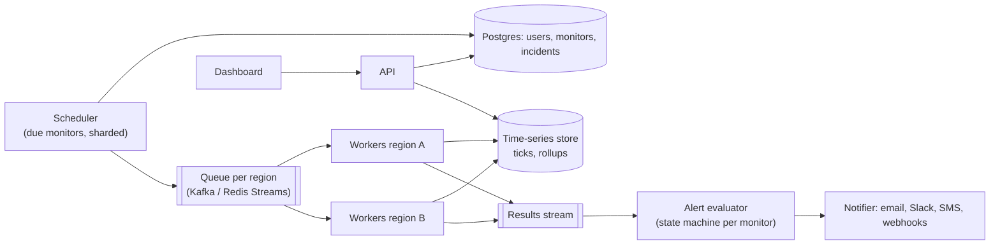

# 09: System design: "Design an uptime monitor"

**Why this file:** "design a URL shortener / rate limiter / notification system / **uptime monitor**" is a standard design question, and you've already built a small version. Practise answering it in 35–40 minutes using this structure, then do the same for 2–3 other classic questions.

## The interview structure (use it for any design question)

1. **Requirements** (5 min): functional + non-functional. Ask; don't assume.
2. **Estimates** (3 min): rough numbers that drive decisions.
3. **API + data model** (5 min).
4. **High-level design** (10 min): boxes and arrows.
5. **Deep dives** (10 min): the 2–3 hardest parts.
6. **Trade-offs and what you'd do next** (5 min).

## 1. Requirements

**Functional:**
- users add URLs, choose a check interval (30 s – 5 min) and regions;
- the system checks them and stores the results;
- dashboards show uptime and latency;
- alerts go out when a site goes down and when it recovers.

**Non-functional:**
- **timely:** a check is never more than one interval late;
- **no false alarms:** a single blip shouldn't page anyone;
- **highly available:** the monitor must be up when sites are down;
- **scale:** 1M monitors.

Questions to ask the interviewer:
- How fast must alerts arrive?
- Which kinds of checks are in scope (HTTP only, or keyword, SSL, ping)?
- How long must history be kept?

## 2. Estimates (show your arithmetic)

- 1M monitors × 3 regions, average interval 1 min → **3M checks/min ≈ 50k checks/s**.
- Each check holds a socket for up to the timeout. At ~0.5 s average, that's 25k concurrent requests. At ~1k concurrent requests per worker process, you need **~25–50 workers** (more for headroom).
- Each tick is about 50 bytes → 50k/s × 50 B = 2.5 MB/s ≈ **216 GB/day raw**. You can't keep raw data forever: keep **7 days raw** and **hourly rollups** for a year.

## 3. API and data model

```
POST /monitors {url, intervalSec, regions[]}   GET /monitors   GET /monitors/:id/ticks?from&to
monitors(id, user_id, url, interval_sec, next_check_at, regions[], state)
ticks(monitor_id, region, ts, status, latency_ms, http_status, error)    -- time-series store, partitioned by day
rollups_hourly(monitor_id, region, hour, up, down, avg_ms, p95_ms)
incidents(id, monitor_id, started_at, resolved_at, cause)
```

## 4. High-level design



How it differs from **your** bstack:

| bstack today | At scale | Why |
|---|---|---|
| Pusher queues **all** websites every 3 min | **Scheduler** queues only monitors whose `next_check_at` ≤ now; sharded by monitor id | per-monitor intervals; no thundering herd every 3 min |
| One stream, a group per region | a queue/topic per region (partitioned) | regions scale and fail independently |
| Postgres table for ticks | time-series DB or partitioned table + rollups + retention | write volume and storage |
| No alerting | results stream → **alert evaluator** → notifier | the actual product |

## 5. Deep dives (pick what the interviewer cares about)

**A. Avoiding false alarms.** Use a per-monitor state machine: Up → *Suspect* (1 region failed) → Down (≥2 regions failed, or N consecutive failures) → Recovering → Up. Alert only on the transition to Down, and once on recovery.

**B. Exactly one alert.** The alert evaluator is partitioned by monitor id, so one consumer owns each monitor's state. Each incident gets an id, and the notifier dedupes on it (idempotency). That gives at-least-once delivery with deduplication.

**C. Scheduling at scale.**
- Store `next_check_at` per monitor.
- Scheduler shards each poll "due" monitors with `SELECT … WHERE next_check_at <= now() … FOR UPDATE SKIP LOCKED`.
- Alternatively, use timing wheels in memory.
- Add jitter so 1M monitors don't all fire at :00.

**D. Worker isolation.**
- Timeouts on every check.
- Concurrency limits per worker.
- Per-domain rate limits, so you don't DoS a customer's site.
- **SSRF protection**: block internal IP ranges.
- Workers are stateless and autoscale on queue lag.

**E. Monitoring the monitor.**
- Heartbeat checks of known-good URLs from each region.
- Alert on queue lag and scheduler delay.
- Run the alerting path in a separate failure domain from the dashboard.

## 6. Trade-offs to say out loud

- **Polling vs push:** you can't push from arbitrary websites, so polling it is; costs scale with interval × monitors.
- **Consistency:** dashboards can be eventually consistent (seconds behind); alerts must be timely.
- **Kafka vs Redis Streams:** Kafka for durable, partitioned, replayable volume; Redis is simpler at small scale (what you used).
- **Time-series DB vs Postgres partitions:** a specialised store (TimescaleDB, ClickHouse) compresses and aggregates far better; Postgres keeps one fewer system to run.

## Practice

- [ ] Answer this question aloud in 35 minutes with a timer, drawing on paper.
- [ ] Do the same for: **URL shortener**, **rate limiter**, **notification system**, **chat app**. These four plus this one cover most entry-level design rounds.
- [ ] For each, write down: two numbers you estimated, one deep dive, one trade-off.

<details><summary>Recall: why "≥2 regions failed" before alerting?</summary>

One region failing is often that region's network, not the site. Requiring agreement from multiple vantage points cuts false alarms while still catching real outages.
</details>

<details><summary>Recall: why per-monitor `next_check_at` instead of "queue everything every N minutes"?</summary>

It supports different intervals per monitor and spreads load evenly over time instead of a burst every N minutes. It also makes "is a check late?" measurable.
</details>

## Resources

- System Design Primer: https://github.com/donnemartin/system-design-primer
- ByteByteGo (Alex Xu), *System Design Interview* vol. 1 (rate limiter, notification system chapters)
- Hello Interview's system design guides: https://www.hellointerview.com/learn/system-design
